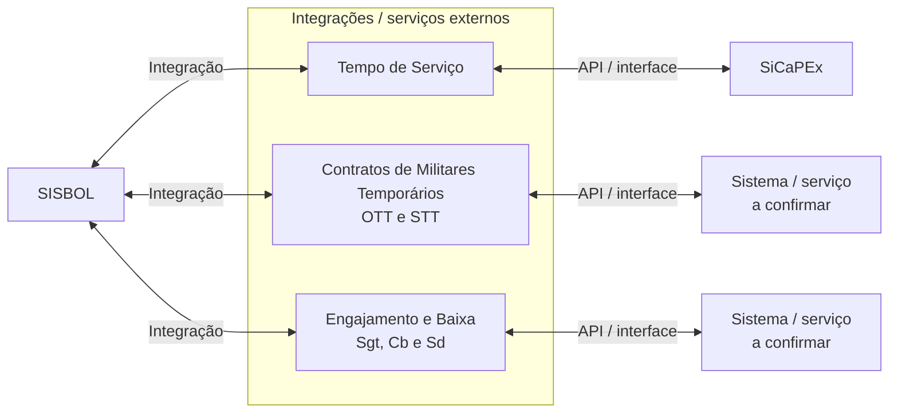

# Mapa de Integrações do SISBOL

Este documento apresenta, em uma única visão, as integrações associadas ao **Sistema Informatizado de Boletins e Alterações (SISBOL)** no contexto do ACT nº 01/2026 FHE-DGP.

> O mapa consolida as integrações previstas, mas não substitui a documentação específica das APIs. Endpoints, operações, principais campos, contratos de entrada e saída e demais detalhes técnicos devem permanecer na documentação própria das interfaces.
>
> As funcionalidades de integração identificadas a partir do cronograma físico-financeiro representam planejamento pactuado com a MJR. A inclusão neste mapa não comprova implementação, homologação, aceite ou disponibilização em produção.

## 1. Contexto e finalidade

O SISBOL está em processo de modernização e evolução, incluindo arquitetura, base de dados, interfaces e funcionalidades relacionadas à gestão de pessoal. Nesse contexto, estão previstas integrações por meio do desenvolvimento e consumo de APIs, especialmente entre SISBOL e SiCaPEx, buscando permitir automação e sincronização de dados relevantes.

Este mapa tem por finalidade representar o **SISBOL como sistema central** e fornecer uma visão consolidada das interfaces e serviços externos relacionados às integrações previstas no projeto.

## 2. Escopo

### Contempla

- O SISBOL como sistema central do mapa de integrações.
- As integrações e interfaces previstas para comunicação do SISBOL com sistemas ou serviços externos.
- A integração relacionada a **Tempo de Serviço**.
- As funcionalidades de integração relacionadas à **Inclusão, Alteração e Exclusão de Contrato de Militares Temporários (OTT e STT)**.
- As funcionalidades de integração relacionadas a **Engajamento e Baixa de Militares Combatentes (Sgt, Cb e Sd)**.
- A identificação de sistemas ou serviços relacionados, APIs/interfaces, finalidade e visão geral dos fluxos, conforme as definições técnicas forem consolidadas.

### Não contempla

- O detalhamento de endpoints, operações e principais campos das APIs.
- Contratos completos de requisição e resposta.
- Catálogo detalhado de códigos de retorno ou erros das APIs.
- Funcionalidades internas do SISBOL que não participem das integrações representadas neste mapa.
- Integrações não previstas ou ainda não incorporadas formalmente ao escopo técnico aplicável.

## 3. Visão geral das integrações

O diagrama abaixo representa o SISBOL como elemento central e consolida, em uma única visão, as integrações previstas.

> **Importante:** somente a integração de **Tempo de Serviço** está explicitamente identificada no cronograma como integração entre SISBOL e SiCaPEx. Para as funcionalidades de Contratos de Militares Temporários e Engajamento/Baixa, o cronograma registra integração com o SISBOL, mas o sistema ou serviço do outro lado da interface deverá ser confirmado na especificação técnica correspondente.

### 3.1 Leitura do diagrama

- **SISBOL:** sistema central representado pelo mapa.
- **Tempo de Serviço:** integração prevista entre SISBOL e SiCaPEx.
- **Contratos de Militares Temporários:** conjunto de funcionalidades previstas de inclusão, alteração e exclusão de contratos OTT e STT. O sistema ou serviço externo relacionado deverá ser confirmado tecnicamente.
- **Engajamento e Baixa:** conjunto de funcionalidades previstas para Sgt, Cb e Sd. O sistema ou serviço externo relacionado deverá ser confirmado tecnicamente.
- As setas representam relações de integração em nível de mapa e **não definem, por si só, protocolo, operação, sentido técnico da chamada ou contrato da API**.

## 4. Interfaces e serviços representados

### 4.1 Tempo de Serviço

**Finalidade:**  
[PREENCHER: descrever a finalidade funcional da integração de Tempo de Serviço conforme demanda, backlog ou especificação técnica aprovada.]

**Sistema central:** SISBOL  
**Sistema / serviço relacionado:** SiCaPEx  
**API / Interface:** [PREENCHER]  
**Origem da chamada:** [PENDENTE DE DEFINIÇÃO TÉCNICA]  
**Destino da chamada:** [PENDENTE DE DEFINIÇÃO TÉCNICA]

**Descrição:**

[PREENCHER: descrever objetivamente como a integração relacionada a Tempo de Serviço participa do fluxo entre SISBOL e SiCaPEx.]

**Escopo específico:**

- Contempla: informações e operações relacionadas a Tempo de Serviço que forem definidas na especificação técnica da integração.
- Não contempla: funcionalidades de Contratos de Militares Temporários e de Engajamento/Baixa.

**Fluxos alternativos ou exceções relevantes:**

- [PREENCHER somente quando a situação alterar de forma relevante a compreensão do fluxo geral.]

**Referências técnicas:**

| Referência | Localização |
|---|---|
| Documentação da API / interface | [PREENCHER] |
| Demanda ou item de backlog | [PREENCHER] |
| Outra referência necessária | [PREENCHER, se houver] |

### 4.2 Contratos de Militares Temporários — OTT e STT

**Finalidade:**  
[PREENCHER: descrever a finalidade funcional da integração de contratos de militares temporários conforme demanda, backlog ou especificação técnica aprovada.]

**Sistema central:** SISBOL  
**Sistema / serviço relacionado:** [PENDENTE DE DEFINIÇÃO TÉCNICA]  
**API / Interface:** [PREENCHER]  
**Origem da chamada:** [PENDENTE DE DEFINIÇÃO TÉCNICA]  
**Destino da chamada:** [PENDENTE DE DEFINIÇÃO TÉCNICA]

**Funcionalidades previstas:**

- Inclusão de contrato de militar temporário.
- Alteração de contrato de militar temporário.
- Exclusão de contrato de militar temporário.
- Categorias indicadas no cronograma: OTT e STT.

**Descrição:**

[PREENCHER: descrever como as funcionalidades de contrato se relacionam com o SISBOL e com o sistema ou serviço externo definido para a integração.]

**Escopo específico:**

- Contempla: inclusão, alteração e exclusão de contratos OTT e STT que forem confirmadas na especificação técnica.
- Não contempla: Tempo de Serviço e Engajamento/Baixa.

**Fluxos alternativos ou exceções relevantes:**

- [PREENCHER somente quando a situação alterar de forma relevante a compreensão do fluxo geral.]

**Referências técnicas:**

| Referência | Localização |
|---|---|
| Documentação da API / interface | [PREENCHER] |
| Demanda ou item de backlog | [PREENCHER] |
| Outra referência necessária | [PREENCHER, se houver] |

### 4.3 Engajamento e Baixa de Militares Combatentes

**Finalidade:**  
[PREENCHER: descrever a finalidade funcional da integração de engajamento e baixa conforme demanda, backlog ou especificação técnica aprovada.]

**Sistema central:** SISBOL  
**Sistema / serviço relacionado:** [PENDENTE DE DEFINIÇÃO TÉCNICA]  
**API / Interface:** [PREENCHER]  
**Origem da chamada:** [PENDENTE DE DEFINIÇÃO TÉCNICA]  
**Destino da chamada:** [PENDENTE DE DEFINIÇÃO TÉCNICA]

**Funcionalidades previstas:**

- Engajamento.
- Baixa.
- Categorias indicadas no cronograma: Sgt, Cb e Sd.

**Descrição:**

[PREENCHER: descrever como os processos de engajamento e baixa se relacionam com o SISBOL e com o sistema ou serviço externo definido para a integração.]

**Escopo específico:**

- Contempla: engajamento e baixa de Sgt, Cb e Sd que forem confirmados na especificação técnica.
- Não contempla: Tempo de Serviço e Contratos de Militares Temporários OTT/STT.

**Fluxos alternativos ou exceções relevantes:**

- [PREENCHER somente quando a situação alterar de forma relevante a compreensão do fluxo geral.]

**Referências técnicas:**

| Referência | Localização |
|---|---|
| Documentação da API / interface | [PREENCHER] |
| Demanda ou item de backlog | [PREENCHER] |
| Outra referência necessária | [PREENCHER, se houver] |

## 5. Dependências, restrições e pontos de atenção

### Dependências

- Definição e disponibilização das APIs e interfaces necessárias às integrações representadas.
- [PREENCHER: demais dependências confirmadas na especificação técnica, backlog ou documentação aplicável.]

### Restrições

- [PREENCHER: registrar apenas restrições documental ou tecnicamente confirmadas.]

### Pontos de atenção

- O diagrama deve permanecer como uma **visão consolidada**, evitando a criação de diagramas individuais para cada interface quando a visão geral for suficiente.
- Alterações relevantes na arquitetura de integração devem ser refletidas no diagrama geral e nas descrições das interfaces afetadas.
- O sistema ou serviço externo das integrações de Contratos de Militares Temporários e Engajamento/Baixa deverá permanecer como pendente enquanto não houver definição técnica suficiente.
- O sentido das setas do diagrama não deve ser interpretado como definição da origem técnica das chamadas enquanto esse dado estiver pendente.

## 6. Referências técnicas

| Referência | Localização |
|---|---|
| Documentação da API de Tempo de Serviço | [PREENCHER] |
| Documentação da interface de Contratos OTT/STT | [PREENCHER] |
| Documentação da interface de Engajamento/Baixa | [PREENCHER] |
| Backlog técnico do projeto | [PREENCHER] |
| Outras referências técnicas | [PREENCHER, se houver] |

## 7. Referências documentais

- ACT nº 01/2026 FHE-DGP: [INSERIR LOCALIZAÇÃO]
- Plano de Trabalho do ACT nº 01/2026: [INSERIR LOCALIZAÇÃO]
- Projeto Básico aplicável: [INSERIR LOCALIZAÇÃO]
- Contrato nº 2486/2026: [INSERIR LOCALIZAÇÃO]
- Cronograma Físico-Financeiro pactuado com a MJR: [INSERIR LOCALIZAÇÃO]

> **Nota de controle:** os elementos marcados como `[PREENCHER]` ou `[PENDENTE DE DEFINIÇÃO TÉCNICA]` não devem ser completados por inferência. Devem ser atualizados somente quando houver fundamento na especificação técnica, backlog, documentação de API ou outro registro formal aplicável.
