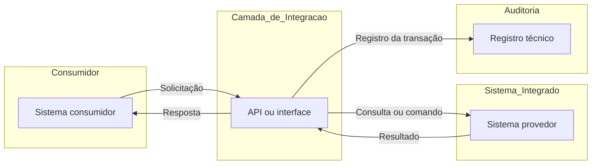

# Mapa da Integração — [NOME DA INTEGRAÇÃO]

> Este documento descreve o mapa técnico de uma integração específica.
> O controle de versão, a TAG, a localização no Git e as regras de manutenção do artefato são registrados no documento de governança em Word.

## 1. Finalidade

[PREENCHER: informar para que a integração existe, qual necessidade atende e qual resultado é esperado.]

## 2. Contexto

[PREENCHER: descrever o processo, funcionalidade ou situação em que a integração é utilizada.]

## 3. Escopo

### 3.1 Contempla

- [PREENCHER]
- [PREENCHER]

### 3.2 Não contempla

- [PREENCHER]
- [PREENCHER]

## 4. Sistemas envolvidos

| Papel no fluxo | Sistema ou componente | Responsabilidade na integração |
|---|---|---|
| Origem | [PREENCHER] | [PREENCHER] |
| Interface / API | [PREENCHER] | [PREENCHER] |
| Destino | [PREENCHER] | [PREENCHER] |

> Inclua linhas adicionais quando houver mais de um sistema, API, barramento, serviço ou componente participante.

## 5. Visão geral da integração

| Campo | Descrição |
|---|---|
| Sistema de origem | [PREENCHER] |
| Sistema de destino | [PREENCHER] |
| API ou interface utilizada | [PREENCHER] |
| Direção principal | [ORIGEM] → [API / INTERFACE] → [DESTINO] |
| Finalidade da integração | [PREENCHER] |

## 6. Fluxo da integração

### 6.1 Descrição do fluxo

1. [PREENCHER: evento ou ação que inicia o fluxo.]
2. [PREENCHER: solicitação enviada pelo sistema de origem.]
3. [PREENCHER: processamento realizado pela API ou interface.]
4. [PREENCHER: interação com o sistema de destino.]
5. [PREENCHER: resposta ou resultado devolvido ao sistema de origem.]

### 6.2 Exceções relevantes

| Situação | Comportamento esperado |
|---|---|
| [PREENCHER] | [PREENCHER] |

## 7. Informações envolvidas

> Registrar somente as principais informações necessárias para compreender o mapa. O detalhamento dos campos deve permanecer na documentação específica da API.

| Informação ou grupo de informações | Origem | Destino | Finalidade no fluxo |
|---|---|---|---|
| [PREENCHER] | [PREENCHER] | [PREENCHER] | [PREENCHER] |

## 8. Operações relacionadas

> Esta seção identifica as operações utilizadas pela integração sem reproduzir toda a especificação técnica da API.

| Operação | Finalidade | Referência na documentação da API |
|---|---|---|
| [PREENCHER] | [PREENCHER] | [PREENCHER] |

## 9. Dependências e restrições

### 9.1 Dependências

- [PREENCHER]

### 9.2 Restrições conhecidas

- [PREENCHER]

## 10. Pontos de atenção

- [PREENCHER: condição, risco técnico, comportamento ou aspecto relevante para compreensão da integração.]

## 11. Referências técnicas

| Referência | Localização |
|---|---|
| Documentação da API | [PREENCHER] |
| Demanda ou item de backlog relacionado | [PREENCHER] |
| Sistema de origem | [PREENCHER] |
| Sistema de destino | [PREENCHER] |
| Outra referência técnica | [PREENCHER] |
