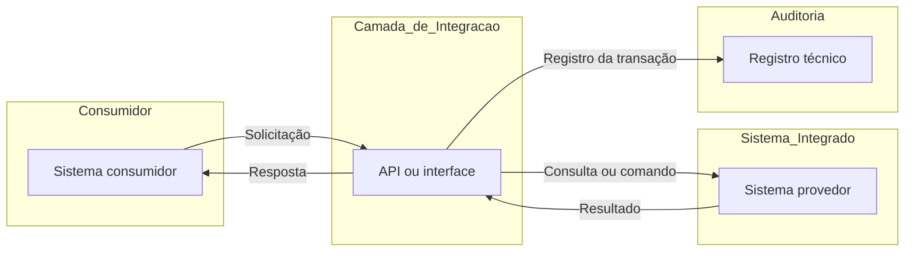

# Mapa da Integração — [NOME DA INTEGRAÇÃO]

> Este documento descreve uma integração específica, identificando sua finalidade, os sistemas participantes, a API ou interface utilizada e o fluxo entre origem e destino.
> O detalhamento de endpoints, operações e campos pertence à documentação específica da API.

## 1. Contexto e finalidade

[PREENCHER: explicar brevemente em qual processo ou funcionalidade a integração é utilizada, por que ela existe e qual resultado atende.]

## 2. Escopo

### Contempla

- [PREENCHER: Ex.: Integração relacionada à...]
- [PREENCHER: Ex.: Solicitação, processamento e/ou retorno...]

### Não contempla

- [PREENCHER, se houver]

## 3. Fluxo da integração

### Descrição do fluxo

1. [PREENCHER: o que inicia a integração.]
2. [PREENCHER: como a origem aciona a API ou interface.]
3. [PREENCHER: como ocorre a interação com o destino.]
4. [PREENCHER: como o resultado retorna à origem.]

### Exceções relevantes

- [PREENCHER somente quando necessário.]

## 4. Dependências, restrições e pontos de atenção

- **Dependências:** [PREENCHER, se houver]
- **Restrições:** [PREENCHER, se houver]
- **Pontos de atenção:** [PREENCHER, se houver]

## 5. Referências técnicas

| Referência | Localização |
|---|---|
| Documentação da API / interface | [PREENCHER] |
| Demanda ou backlog relacionado | [PREENCHER] |
| Outra referência necessária | [PREENCHER, se houver] |
