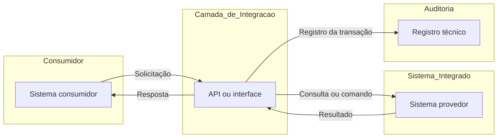

# Registro da Integração: [NOME DA INTEGRAÇÃO]

> **Situação do documento:** modelo de registro técnico pendente de preenchimento e validação.
>
> Este documento registra a integração em nível de mapa e rastreabilidade. Não substitui a documentação detalhada da API, as evidências de teste nem os documentos formais de homologação, validação ou aceite.
>
> A existência de commit, merge, release ou tag no Git não representa, isoladamente, homologação, validação ou aceite formal.

## 1. Identificação

| Campo | Valor |
|---|---|
| ID da integração | `INT-[PREENCHER]` |
| Nome da integração | [PREENCHER] |
| Situação técnica | [proposta / em desenvolvimento / disponível para homologação / homologada / descontinuada] |
| Versão documental | `0.1.0` |
| Tag Git | [PENDENTE] |
| Commit de referência | [PENDENTE] |
| Data da última atualização | [PENDENTE] |
| Data da última revisão técnica | [PENDENTE] |
| Responsável técnico pelo registro | [PENDENTE] |
| Responsável de negócio | [PENDENTE] |
| Classificação da informação | Ostensivo / [REAVALIAR, SE APLICÁVEL] |

## 2. Finalidade da integração

[PREENCHER: descrever objetivamente a necessidade atendida, o sistema consumidor, o resultado esperado e a contribuição da integração para o processo relacionado.]

## 3. Contexto e escopo

### 3.1 Contexto

[PREENCHER: informar em qual processo, funcionalidade, módulo ou evento a integração é acionada.]

### 3.2 Contempla

- [PREENCHER]
- [PREENCHER]
- [PREENCHER]

### 3.3 Não contempla

- [PREENCHER]
- [PREENCHER]

## 4. Sistemas, componentes e interfaces

| Papel | Sistema ou componente | Módulo | Responsabilidade no fluxo |
|---|---|---|---|
| Origem / consumidor | [PREENCHER] | [PREENCHER] | [PREENCHER] |
| Intermediação / API | [PREENCHER] | [PREENCHER] | [PREENCHER] |
| Destino / provedor | [PREENCHER] | [PREENCHER] | [PREENCHER] |
| Auditoria / observabilidade | [PREENCHER] | [PREENCHER] | [PREENCHER] |

### 4.1 Direção do fluxo

`[ORIGEM] -> [API OU INTERFACE] -> [DESTINO] -> [RETORNO]`

### 4.2 Finalidade da interface

[PREENCHER]

### 4.3 Características da comunicação

| Item | Informação |
|---|---|
| Protocolo ou mecanismo | [PENDENTE] |
| Padrão de dados | [PENDENTE] |
| Tipo de processamento | [síncrono / assíncrono / lote / evento / PENDENTE] |
| Sentido da comunicação | [unidirecional / bidirecional / PENDENTE] |
| Frequência ou gatilho | [PENDENTE] |
| Ambientes abrangidos | [PENDENTE] |

## 5. Demandas, requisitos e entregas relacionadas

| Tipo | Identificador | Descrição | Link ou referência | Situação |
|---|---|---|---|---|
| Backlog | [PENDENTE] | [PREENCHER] | [PENDENTE] | [PENDENTE] |
| Requisito | [PENDENTE] | [PREENCHER] | [PENDENTE] | [PENDENTE] |
| Entrega | [PENDENTE] | [PREENCHER] | [PENDENTE] | [PENDENTE] |
| Teste | [PENDENTE] | [PREENCHER] | [PENDENTE] | [PENDENTE] |
| Defeito | [PENDENTE] | [PREENCHER] | [PENDENTE] | [PENDENTE] |

## 6. Fluxo da integração

### 6.1 Fluxo principal

1. [PREENCHER]
2. [PREENCHER]
3. [PREENCHER]
4. [PREENCHER]
5. [PREENCHER]

### 6.2 Fluxos alternativos e exceções

| Cenário | Condição | Comportamento esperado | Código ou retorno | Referência |
|---|---|---|---|---|
| [PREENCHER] | [PREENCHER] | [PREENCHER] | [PENDENTE] | [PENDENTE] |

## 7. Contrato da integração

> Os detalhes completos de endpoints, operações, schemas, campos, exemplos e respostas devem permanecer na documentação específica da API.

| Item | Referência |
|---|---|
| Nome da API ou interface | [PENDENTE] |
| Versão da API | [PENDENTE] |
| Especificação da API | [PENDENTE] |
| Operações utilizadas | [PENDENTE] |
| Principais categorias de dados | [PENDENTE] |
| Autenticação e autorização | [PENDENTE] |
| Catálogo de erros | [PENDENTE] |
| Política de compatibilidade | [PENDENTE] |
| Política de indisponibilidade ou nova tentativa | [PENDENTE] |

## 8. Segurança, privacidade e auditoria

| Item | Informação ou referência |
|---|---|
| Perfis ou permissões envolvidos | [PENDENTE] |
| Mecanismo de autenticação | [PENDENTE] |
| Mecanismo de autorização | [PENDENTE] |
| Registros de auditoria previstos | [PENDENTE] |
| Identificador de correlação ou transação | [PENDENTE] |
| Dados pessoais envolvidos | [PENDENTE] |
| Classificação dos dados | [PENDENTE] |
| Restrição de acesso à documentação | [PENDENTE] |
| Referência da avaliação aplicável | [PENDENTE] |

> **Não registrar neste arquivo:** tokens, senhas, chaves, certificados, segredos, dados pessoais reais ou payloads obtidos de produção.

## 9. Dependências, restrições e impactos

### 9.1 Dependências técnicas

- [PREENCHER]

### 9.2 Dependências organizacionais ou externas

- [PREENCHER]

### 9.3 Restrições conhecidas

- [PREENCHER]

### 9.4 Sistemas ou componentes impactados

- [PREENCHER]

### 9.5 Impactos operacionais conhecidos

- [PREENCHER]

## 10. Riscos e pontos em aberto

| ID | Risco ou pendência | Impacto | Tratamento ou decisão necessária | Responsável | Situação |
|---|---|---|---|---|---|
| R-01 | [PREENCHER] | [PREENCHER] | [PENDENTE] | [PENDENTE] | Aberto |

## 11. Testes e evidências

| Cenário | Requisito ou demanda | Resultado esperado | Resultado obtido | Situação | Evidência | Defeito relacionado |
|---|---|---|---|---|---|---|
| CT-001 | [PENDENTE] | [PREENCHER] | [PENDENTE] | Não executado | [PENDENTE] | [PENDENTE] |

### 11.1 Critérios verificados

- [ ] O fluxo percorre os sistemas e componentes previstos.
- [ ] A resposta retorna ao sistema ou processo consumidor.
- [ ] Os cenários de sucesso e de exceção estão documentados.
- [ ] Os registros técnicos permitem localizar a transação sem expor dados indevidos.
- [ ] As permissões e os controles de acesso foram verificados.
- [ ] Os defeitos críticos identificados foram registrados e tratados.
- [ ] A documentação da API e o mapa da integração estão atualizados.

## 12. Implantação e situação por ambiente

| Ambiente | Versão ou tag | Commit | Data | Situação | Autorização ou referência |
|---|---|---|---|---|---|
| Desenvolvimento | [PENDENTE] | [PENDENTE] | [PENDENTE] | [PENDENTE] | [PENDENTE] |
| Homologação | [PENDENTE] | [PENDENTE] | [PENDENTE] | [PENDENTE] | [PENDENTE] |
| Produção | [PENDENTE] | [PENDENTE] | [PENDENTE] | [PENDENTE] | [PENDENTE] |

## 13. Homologação, validação e aceite

| Registro | Referência | Data | Observação |
|---|---|---|---|
| Validação técnica | [PENDENTE] | [PENDENTE] | [PENDENTE] |
| Homologação | [PENDENTE] | [PENDENTE] | [PENDENTE] |
| Aceite | [PENDENTE] | [PENDENTE] | [PENDENTE] |

> Este registro somente deve indicar uma entrega como homologada, validada ou aceita quando houver referência ao respectivo documento formal.

## 14. Operação, suporte e observabilidade

| Item | Informação ou referência |
|---|---|
| Monitoramento técnico | [PENDENTE] |
| Registro de logs | [PENDENTE] |
| Alertas aplicáveis | [PENDENTE] |
| Procedimento de suporte | [PENDENTE] |
| Componente ou equipe de referência | [PENDENTE] |
| Procedimento de contingência | [PENDENTE] |

## 15. Decisões técnicas relacionadas

| ID | Decisão | Justificativa | Referência | Data |
|---|---|---|---|---|
| ADR-[PENDENTE] | [PREENCHER] | [PREENCHER] | [PENDENTE] | [PENDENTE] |

## 16. Referências

- ACT nº 01/2026 FHE-DGP: [INSERIR REFERÊNCIA]
- Plano de Trabalho do ACT nº 01/2026: [INSERIR REFERÊNCIA]
- Projeto Básico aplicável: [INSERIR REFERÊNCIA]
- Contrato nº 2486/2026: [INSERIR REFERÊNCIA]
- Backlog técnico: [PENDENTE]
- Documentação da API: [PENDENTE]
- Especificação OpenAPI ou equivalente: [PENDENTE]
- Evidências de teste: [PENDENTE]
- Documento de homologação, validação ou aceite: [PENDENTE]
- Ata ou decisão relacionada: [PENDENTE]

## 17. Controle de alterações relevantes

> O histórico completo permanece no Git. Esta seção registra apenas mudanças relevantes para compreensão, operação, escopo ou rastreabilidade da integração.

| Versão | Data | Alteração relevante | Demanda ou decisão | Responsável |
|---|---|---|---|---|
| 0.1.0 | [PENDENTE] | Criação inicial do registro. | [PENDENTE] | [PENDENTE] |

## 18. Declarações de controle

- O histórico Git apoia a rastreabilidade técnica, mas não substitui atas, revisões de escopo ou instrumentos formais.
- A documentação deve ser atualizada quando a integração, o contrato da API, o fluxo, os riscos ou as referências de evidência forem alterados.
- Commit, merge, release e tag não comprovam, isoladamente, implantação, homologação ou aceite.
- Campos sem base documental ou evidência devem permanecer marcados como `[PENDENTE]`.
- Esta minuta não se torna fonte documental até ser aprovada, emitida, assinada ou formalizada e posteriormente incorporada ao repositório institucional aplicável.
